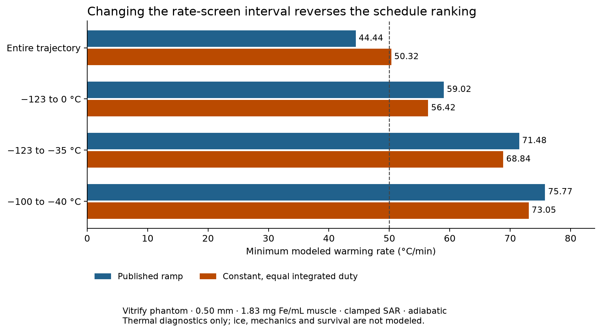

# Results of the three selected investigations

**Later significance correction:** The [skeptical reassessment](reassessment-2026-11-26/README.md) supersedes novelty/importance and “accepted result” language below. These numerical results do not demonstrate improved preservation, reduced stress or biological recovery. One small Rubisco pairing correction and a conditional library inference survive, with impact still unestablished. Original numerical work is retained for inspection.

26 November 2026. Computational research only. Independent Sol review supports the precise new thermal contribution after the corrections below. The complete coordinator thermal rerun passes and all nine selected outputs match the original completed worker manifest. Four central cases also pass fresh coordinator execution in the separate reviewer solver. The supported novelty is the bounded benchmark/counterexample described below, not a claim of universal priority or biological recovery.

## Cryopreservation: a new thermal counterexample, with bounded novelty

The accepted result is a reproducible robustness benchmark for the released Vitrify heart phantom. It compares frozen published schedules under explicit changes in myocardial nanoparticle delivery and in the temperature support of the rate criterion. The geometry is synthetic, matched to published dimensions/volumes, rather than an anatomical reconstruction or a living organ. The result concerns thermal criteria, not survival, fracture safety or a complete Millennium solution.

At uniform 1.83 mg Fe/mL myocardial loading and clamped low-temperature SAR, replacing the released margin ramp with its constant time-average duty, while retaining its surrounding iron shell, gives a conditional thermal pass on seven refined meshes. At 0.30 mm the all-time minimum is about 50.30 rather than 44.44 °C/min; both endpoints satisfy the specified temperature bounds. Integrated commanded duty is equal. Absorbed heat is temperature-dependent and is not forced equal. The pass has a small margin, assumes an adiabatic exterior and does not include mechanical re-evaluation.

The apparent advantage reverses in the highlighted −100 to −40 °C ice-growth region: the ramp's minimum is about 75.63 versus 72.94 °C/min for constant duty at 0.30 mm. The original all-time constraint includes storage temperatures below the glass transition. Earlier publications already distinguish ice and fracture temperature regions; that principle is not a discovery. The supported new result is the specific independently reproduced counterexample and quantified delivery/criterion dependence for these released designs.

The coordinator additionally tested the broader glass-to-end interval from the [earlier heart thermal model](https://pmc.ncbi.nlm.nih.gov/articles/PMC8823202/), rather than relying on the narrower highlighted interval. At 0.50 mm and the same high-loading/clamped case:

| Temperature support for minimum rate | Published ramp | Constant equal-duty | Higher minimum |
|---|---:|---:|---|
| Entire trajectory from −150 °C | 44.4358 | 50.3155 | Constant |
| Local −123 to 0 °C | 59.0170 | 56.4182 | Ramp |
| Local −123 to −35 °C | 71.4809 | 68.8450 | Ramp |
| Local −100 to −40 °C | 75.7682 | 73.0548 | Ramp |

Rates are °C/min. End temperatures are unchanged by the diagnostic: ramp −32.99 to −12.84 °C, constant −32.66 to −12.99 °C. Across eight fixed delivery/SAR combinations, constant duty has the higher all-time minimum in seven; the ramp has the higher minimum in all eight for each of the three restricted windows. This is a prespecified-equation sensitivity calculated after seeing the original result, not an independently preregistered experiment. [All 64 runs](archive/verification/cryo-window-extension/windows.csv), [paired rankings](archive/verification/cryo-window-extension/rankings.csv) and [source/code provenance](archive/verification/cryo-window-extension/provenance.json). Both original all-time and narrow-window outputs match the worker's existing 16 corresponding cases within 10⁻⁹.

At the same total iron, two constructed half-muscle redistributions also turn the nominal released margin design's all-time pass into failure. These maps are deterministic sensitivity cases, not measured spatial distributions or a probability model. Fine-grid terminal cold-spot differences survive changing which half is depleted, but hard endpoint decisions near −35 °C depend on voxelization. Bulk assays alone cannot certify local-rate feasibility under this criterion.

Read this corrected synthesis alongside the [original thermal report](archive/agents/cryo-robust-astra/report.md), [frozen scope](archive/agents/cryo-robust-astra/preregistration.md), [primary-source inventory](archive/agents/cryo-robust-astra/sources.md), and [completed independent review](archive/agents/review-cryo-sol/report.md). The original report is preserved as a research record, including the unsupported empirical assertion explicitly rejected below. The coordinator's broader-temperature-support sensitivity changes only the rate-screen bounds; the independent reviewer separately implements the thermal equations.

### Accepted corrections and limits

- **Drop the empirical triplicate inference.** The original report's bold claim that the reported triplicate excludes universal feasibility is not accepted. The primary text reports 1.47 ± 0.36 mg Fe/mL, while the n=3 figure plots iron per dry weight. Neither article nor supplement documents the conversion needed to establish the relevant triplet's volumetric moments. The inequality `minimum ≤ mean − sample_SD/√3` is valid conditional mathematics; it does not establish that one measured heart must fail. No empirical heart-failure count or population probability follows. The deterministic loading sensitivity and thermal counterexample do not depend on this inference.
- **Distinguish command equality from heat equality.** Both intended schedules integrate to 66.97622646 duty-seconds over exactly 70 s. The original discrete Euler convention has a small integration/horizon discrepancy. The independent exact-horizon RK2 calculation preserves the result. Absorbed heat differs slightly because SAR depends on temperature.
- **Do not contradict fixed-input infeasibility.** Raising muscle iron to 1.83 changes the upstream 1.47 input. The original clamped-SAR infeasibility at that fixed input remains valid. The new conditional pass is narrow and is not a certified practical loading strategy.
- **Restrict the ranking claim.** The reversal occurs in the named clamped high-loading case and several other cases, not universally. Under extrapolated SAR at high loading, the ramp wins both rate comparisons. The coordinator's eight-case table preserves this exception.
- **Keep the physical boundary explicit.** The reviewer reproduces the pass at 0.75, 0.50 and 0.30 mm. A prescribed cold-boundary heat-loss test eliminates it, and small local Fe deficits eliminate all-time clearance. Those tests do not measure the experiment's environment. No ice-kinetics, stress, fracture, toxicity or recovery advantage is established.

The separate solver also checks units, exact nonlinear scalar heating, zero-source preservation, symmetric cells, conservation and crossing interpolation. Its 22 main runs have complete crossings and maximum relative energy imbalance 1.98×10⁻⁷. [Full coordinator thermal rerun](archive/verification/cryo-full-reproduction.json), independent-review [sources](archive/agents/review-cryo-sol/sources.md) and verification (archival input; see source-downloads.json and the source URLs). [Fresh coordinator execution of the separate solver](archive/verification/cryo-independent-reproduction/verification.json) confirms the central signs and decisions. The original report and its original checksum record remain unchanged; this accepted-results document and the independent review control interpretation.

### Priority check and exact supported claim

The [Vitrify release](https://github.com/Marc-Dvci/Vitrify/tree/1d498ee5c583e0112a762e60892d576ec2e27f57) already contains inverse design, numerical rate margins and the clamped-versus-extrapolated SAR comparison. The coordinator's fresh GitHub snapshot finds this still the latest commit on 26 November 2026, last pushed 10 August, with no issues/PRs returned by the all-state endpoint. [Snapshot](archive/verification/cryo-upstream-priority-snapshot.json). This finite repository check does not cover unpublished work, other branches or the whole internet.

Earlier [heart thermal modeling](https://pmc.ncbi.nlm.nih.gov/articles/PMC8823202/) already studies different compartment loadings and applies CWR above the glass transition. [Power modulation for heterogeneous nanoparticle distributions](https://doi.org/10.1080/02656736.2018.1538538) is also known in magnetic hyperthermia. The [October 2026 pig-kidney preprint](https://doi.org/10.64898/2026.10.07.756990) already uses staged heating. None of those general ideas is claimed new. Coordinator searches covered nanowarming, robust optimization, RF schedules, nanoparticle heterogeneity, rate constraints, temperature windows and Vitrify, with latest 2026 sources checked. No exact equivalent of the finite benchmark/counterexample was found. The independent review supports the precise calculation as incremental computational progress within that search scope.

The independent review additionally located [Skow's August 2026 proposal](https://doi.org/10.67690/tbfhva49), whose sections 6.1–6.3 explicitly discuss weakest-region margins, equal-total-iron nonuniformity tests and feedback control. The coordinator independently extracted and checked its full primary PDF. **Equal-mean spatial perturbation as an idea is therefore prior art**, and is not counted as our novel contribution. This source offers an illustrative proposal rather than the numerical Vitrify schedule/temperature-support comparison. The independent review accepts the specific numerical contribution after narrowing its interpretation. Primary PDF (archival input; see source-downloads.json and the source URLs).

The supported novelty sentence is: **For the pinned Vitrify heart phantom and released margin shell, a constant equal-integrated-duty schedule conditionally restores the repository's all-time thermal feasibility at uniform 1.83 mg Fe/mL under clamped SAR, but loses to the released ramp when the rate screen is confined to post-glass temperatures; prescribed delivery redistributions separately expose how numerical-grid margins fail to certify delivery robustness.** This is incremental computational progress on evaluating rewarming designs, not a new warming mechanism or an experimentally validated protocol. Universal first-ever priority cannot be established by a bounded literature/code search.

## Rubisco: assay controls and calibration provenance

The [current measurement/control benchmark](archive/agents/rubisco-current-sol/report.md) contains 623 historical/current endpoint records, a separate 469-record 30 °C screen ledger, and explicit control/origin relationships. Its deposited 2025 calibration has eleven overlaps, all originating at 25 °C while the new assay is at 30 °C. Those overlaps identify a combined assay/temperature factor, not separate assay bias and Q10. This does not show the authors' chosen Q10 is wrong. A source-level 2023→2026 audit also identifies a reused turnover error whose SD-to-SE interpretation cannot be reconciled by rounding and the reported sample-count range; the mean is retained and the uncertainty is quarantined pending statistical provenance.

The coordinator freshly reran all eight analysis/verification scripts. All 56 checks passed and the four selected numerical artifacts retained their hashes. Earlier independent release audits additionally identify a source-confirmed grass-to-moss mapping error and reconstructed same-species/sequence fold overlap. The original model was not refitted: its required embeddings and ordered IDs are unavailable. None of these results identifies a better enzyme.

## Programmable proteases: corrected data change the diagnosis

The [complete reconstruction](archive/agents/protease-corrected-sol/report.md) reproduces the authors' final 355,097 enzyme–substrate pairs, 4,437 proteases and 134 intended substrates, including every deposited Figure S8e AUC. It preserves all upstream-key and barcode exclusions. The coordinator reran its complete pipeline, including source-workbook reconciliation and three focused arithmetic tests.

The strong raw holdout-error claim weakens after using the corrected matched population. One already-excluded backbone accounts for 54% of the original excess squared error. Corrected excess RMSE is +0.00201 dimensionless reporter AUC, with a whole-motif bootstrap interval [−0.000724, +0.004939]. This supports neither a robust extrapolation-failure claim nor successful extrapolation. Corrected background recurrence persists within the screen but fails to establish transport across screens. Published corrections improve agreement with the six selected biochemical panels; that improvement belongs to the published correction, not a new method here.

A separate [fixed time-course hypothesis](archive/protease-kinetics/REPORT.md) did not improve the prespecified primary endpoint: mean rank-correlation change −0.00039, 3/6 panels positive, shared-motif bootstrap interval spanning zero. The null is retained without retuning or promoting a favorable secondary score. No new protease or prospective specificity improvement is claimed.

## What the model runs show

The [matched comparison](MODEL_COMPARISON.md) favors Sol 6.1 medium for substantial analysis/code and Astra 6.2 low for quick independent criticism on the measured task. Astra medium also produced the deeper thermal investigation. Different algorithms and data choices prevent treating baseline scores as a fair model leaderboard. Refusals, source-access failures and scientific negative results remain separate in [REFUSALS.md](REFUSALS.md).
