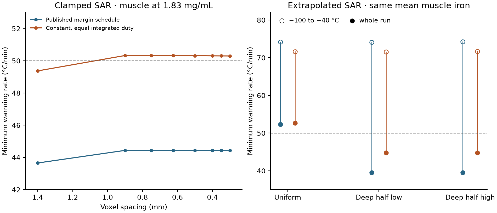

# A grid margin does not cover measured-scale iron variation in the Vitrify rat-heart phantom

**26 November 2026 · Millennium biology problem 02 · computational thermal study**

**At the same total myocardial iron, two spatial redistributions changed a passing design into a failing one under Vitrify’s own thermal criteria.** The published margin schedule gave a minimum of **52.31 °C/min** with uniform muscle iron and **39.51 °C/min** with either half-muscle depletion map at 0.5 mm. The failures occurred near the −150 °C starting state. The corresponding minima while cells actually traversed the published VS55 ice-growth concern window were **74.16, 74.08 and 74.25 °C/min**. All cells finished within the prescribed temperature limits in these three runs. Changing the definition of the rate screen changes the design decision.

A separate comparison found a narrow exception to transferring the repository’s clamped-SAR infeasibility finding across muscle loadings. At a uniform 1.83 mg Fe/mL, holding the published shell fixed and flattening its RF schedule at the same integrated duty **changed fail to pass on seven refined grids**. On the finest, 0.30 mm, the all-time minimum went from **44.44 to 50.30 °C/min**. The price was a *lower* minimum in the ice-growth window, from **75.63 to 72.94 °C/min**. This is a counterexample for a changed input, with a small thermal margin. Mechanical performance of the alternative remains unknown.

## What was compared

Gao et al. quantified iron in loaded rat heart muscle after clearing the chambers. They report 1.47 ± 0.36 mg Fe/mL; Fig. 1e identifies three muscle measurements, and the methods identify error bars as SD. The chamber-cleared assay includes the myocardial vasculature. The assay does not resolve the within-heart distribution. The means of 1.11, 1.47 and 1.83 used here are deterministic sensitivity inputs. The two constructed maps keep the mean at 1.47 and allocate 1.11 and 1.83 to opposite halves by distance to the nearest high-loading chamber or surrounding solution. A median voxel takes the mean when necessary. Ties are broken by voxel index. Swapping the assignments preserves total iron even on a voxelized geometry. No local uncertainty distribution or guaranteed physiological range follows from these choices. [Gao et al., text and Fig. 1e](https://doi.org/10.1002/admt.202100873)

I fixed the comparison, model, temperature windows, validation tolerances, alternative design and signs of the spatial perturbation before computing new scores. The dated specification and SHA-256 record are local and lack an external timestamp. The later loading brackets, triplicate-assay bound and extended grid checks are follow-ups. [Preregistration](preregistration.md) · Digest (archival input; see source-downloads.json and the source URLs)

Four designs used the same fixed chamber concentration of 10 mg Fe/mL. Case II has uniform surrounding solution at 7.5 and full duty. The original optimum and the +1.5 °C/min margin optimum use their exact committed radial shell coefficients and RF ordinates. The margin shell has coefficients 9.0206, 9.4875, 9.7135 mg Fe/mL and duty 0.84464, 0.99129, 1.00000 at 0, 35 and 70 s. The alternative retains that shell and holds duty at **0.956803**, the time average of the piecewise-linear schedule. Integrated commanded duty is identical in continuous time. Deposited heat can differ because SAR depends on temperature. Pinned workflow (archival input; see source-downloads.json and the source URLs) · Margin parameters (archival input; see source-downloads.json and the source URLs)

## Full-field results

The primary screen takes the minimum instantaneous rate over all specimen voxels and times, with a floor of 50 °C/min. It also requires every specimen voxel to finish between −35 and 0 °C. The secondary screen changes only the temperatures over which the rate minimum is taken, to local −100 through −40 °C. Gao et al. identify this as a hazard range for VS55. The local transit statistic is 60 °C divided by each voxel’s interpolated time between the two crossings, converted to °C/min. The slowest transit and incomplete crossing counts are recorded separately. Neither rate screen integrates ice kinetics. [Gao et al., Fig. 3 and thermal discussion](https://doi.org/10.1002/admt.202100873) · [All 180 sweep and time-refinement rows](outputs/sweep.csv)

**Published margin design, extrapolated SAR, 0.5-mm voxels.** Rates are °C/min, final temperatures °C.

| Muscle loading | All-time minimum | In-window minimum | Slowest transit | Final coldest | Final hottest | All-time / window decision |
|---|---:|---:|---:|---:|---:|---|
| Uniform 1.11 | 39.51 | 73.01 | 94.30 | −31.16 | −9.32 | Fail / pass |
| Uniform 1.47 | 52.31 | 74.16 | 95.86 | −29.46 | −9.05 | Pass / pass |
| Uniform 1.83 | 55.20 | 75.28 | 97.43 | −27.81 | −8.77 | Pass / pass |
| Deeper half low, mean 1.47 | 39.51 | 74.08 | 95.73 | −29.74 | −8.93 | Fail / pass |
| Deeper half high, mean 1.47 | 39.51 | 74.25 | 95.99 | −29.18 | −9.16 | Fail / pass |

Every voxel completed both crossings in these five runs. The depleted maps set the lowest rate at or within 0.04 s of onset. Ordering by the all-time minimum rewards initial duty. Ordering by the in-window minimum rewards the published ramp relative to the flat alternative for every loading case at 0.5 mm under both SAR readings. At nominal loading with extrapolated SAR, for example, the flat schedule wins the former comparison 52.68 to 52.31 and loses the latter 71.62 to 74.16. Under high loading the minimum for the extrapolated ramp migrates to the warm end of the run. A single minimum without its location in time and temperature would conceal this change.

**Clamped SAR at uniform 1.83 mg/mL.** The equal-duty schedule satisfies the three published constraints at 0.90, 0.75, 0.625, 0.50, 0.40, 0.35 and 0.30 mm. It fails on the original 1.40-mm design grid (49.37 °C/min, coldest −37.97 °C). At 0.30 mm its coldest/hottest endpoints are −33.09/−13.23 °C; the ramp gives −33.43/−13.07 °C. The alternative’s rate margin is only 0.30 °C/min and its all-time minimum occurs at 0.19 s and −149.84 °C. Its slowest in-window transit is 95.03 °C/min, versus 97.52 for the ramp. Modeled total absorbed heat is 687.21 versus 687.12 J. The positive classification survives refinement even though absolute cold-spot temperatures are sensitive to voxelization. [Refinement outcomes](outputs/refinement.csv) · [Original grids](outputs/sweep.csv)

**Spatial placement also affects a terminal constraint independent of the starting-rate calculation.** With clamped SAR, the published ramp and mean muscle iron fixed at 1.47, depleting the deeper half left the coldest voxel at −35.66 °C (0.30 mm) and −35.42 °C (0.25 mm). Reversing the map gave −34.72 and −34.56 °C. Both placements cleared the in-window rate floor. The terminal difference of 0.87–0.94 °C separates them on those two meshes. At 0.40 mm both narrowly or clearly miss the endpoint, so the sign of the *temperature difference* is better established on the fine grids than a hard pass for the favorable placement. Both arrangements fail the all-time rate screen at onset. [Fine-grid paired runs](outputs/split_fine.csv) · [Intermediate spacings](outputs/split_refinement.csv)

## How much delivery variation is enough?

At the uniform starting temperature conduction contributes zero. The local rate in °C/min is exactly 60,000 times SAR in W/g Fe times concentration in mg/mL times duty, divided by volumetric heat capacity in J/(m³ K). The factor 1000 converts mg/mL to g/m³ and 60 converts seconds to minutes. At −150 °C the capacity is 1,442,178 J/(m³ K). A necessary initial loading under extrapolated SAR is **1.405 mg/mL for the margin ramp** and **1.240 for the flat schedule**. These are necessary conditions at one instant. The simulations separately test conduction, the temperature-dependent source and the full 70 s.

**The reported triplicate already excludes universal all-time feasibility for the published ramp within this model.** If three bulk assays have mean μ and sample SD s, their smallest value is at most μ − s/√3. To see this, suppose all three are at least μ − d. For fixed mean, the greatest sum of squared deviations occurs at deviations (−d, −d, 2d), giving s ≤ √3 d. The sharp upper bound on the smallest input is **1.262 mg/mL**, or **1.270** allowing adverse rounding to the reported hundredths. Even with the more favorable extrapolated SAR, at least one of the three assay-equivalent inputs therefore gives an initial rate **at most 45.21 °C/min** for the margin design. A muscle with nonuniform iron also has a local minimum no greater than its bulk mean under the common material/source model. This inference requires the volumetric summary to describe the Fig. 1e muscle triplicate on a common concentration scale. It says nothing about the fraction of future hearts that would fail, or whether any assayed heart crystallized. An independent enumeration of the circle of all triplets with those two sample moments matched the sharp bound to floating-point precision. [Derivation check and schedule-specific limits](outputs/assay_bound.json)

For clamped SAR the margin ramp needs at least **2.059 mg/mL** at onset, and the flat schedule needs **1.818 mg/mL**. At the measured mean even full initial duty requires 1.739, which explains why the pinned result at its fixed input stands. In the full-field follow-up the constant schedule fails at uniform 1.815 and passes at 1.820 mg/mL on each of 0.50, 0.40 and 0.35 mm; both temperature endpoints pass in all of those runs. Even at a mean of 1.83, a local deficit exceeding **0.01224 mg/mL (0.67%)** guarantees all-time rate failure at onset for that schedule. At fixed mean 1.83, both half-muscle placements passed at ±0.010 and failed at ±0.015 mg/mL on all three grids (0.50, 0.40 and 0.35 mm). Window rates and endpoints stayed above their lower limits, and final maxima stayed below 0 °C. This arithmetic sets a stringent measurement requirement for *that specific criterion*. A 1.83 bulk assay alone cannot certify the conditional pass. [Loading bracket](outputs/loading_boundary.csv) · [Spatial tolerance runs](outputs/local_tolerance.csv)

## Numerical and empirical checks

The solver integrates C(T) ∂T/∂t = div(k(T) grad T) + q in the pinned three-dimensional rat-heart cryobag phantom, with explicit finite volumes, a single equal-and-opposite flux per internal face, harmonic-mean conductivity and temperature-dependent capacity. CPA and muscle use the same VS55 properties. The polyethylene wall conducts and stores energy with zero iron. The design sweep uses an adiabatic exterior. The separate Case III benchmark includes its specified convective boundary. Each original time step and the original duration rounding were retained for exact comparisons. SAR is 691 W/g Fe at −80 °C and 415 at −20 °C. Below −80 °C the two upstream models hold SAR constant or extrapolate linearly. Both remain modeling assumptions. No latent heat, ice, stresses, fracture, biological injury or rewarming controller feedback is integrated. [Thermal implementation](thermal.cpp) · [Geometry and runner](investigate.py) · [Primary constitutive model](https://doi.org/10.1371/journal.pone.0290063)

- **Committed baselines.** All six 0.5-mm Case I–III glass-crossing mean rates (both SAR readings), and 64 nominal whole-run rate/temperature comparisons across both released designs, Case II and four spacings matched with maximum absolute discrepancy 9.1 × 10⁻¹² or less. Extrapolated Case I/II/III give 336.23/212.34/197.07 °C/min against JR23 Table 5 values 340/198/213. This matches scale but reverses II and III. The upstream boolean tests only whether I exceeds both others. Its proxy stopping time is mean-temperature glass crossing, whereas JR23 averaged to peak stress. This is code and simulation benchmarking; there is no direct tissue thermometry validation for the newly scored maps. [All 70 comparisons](outputs/baselines.csv) · Original benchmark definition (archival input; see source-downloads.json and the source URLs)
- **Energy, units and analytic limits.** The independent integral of piecewise volumetric heat capacity over temperature, summed over wall and specimen, differed from integrated source energy by at most **0.0561%** in the sweep. Zero source preserved uniform storage temperature exactly. A uniformly heated adiabatic system reproduced nonlinear heating times from scalar quadrature with maximum temperature error 0.0059 °C at 0.005 s steps. Connected uniform cells stayed identical. Energy and baseline log (archival input; see source-downloads.json and the source URLs) · [Analytic check](outputs/analytic.csv)
- **Space, time and independent integration.** At 0.5 mm halving the step in all 20 extrapolated design/loading combinations changed the all-time minimum by at most 0.0034 °C/min, the window minimum by 0.0102 and the cold endpoint by 0.0047 °C. A separate dense-array, two-stage Runge–Kutta implementation used a different flux traversal, exact 70 s horizon and continuous schedule. At 0.75 mm it recovered the high-loading clamped flip and the low-deep extrapolated failure. Across the three independent runs the largest rate difference was 0.012 °C/min and endpoint difference 0.032 °C. Some secondary terminal classifications change with mesh, particularly clamped SAR at nominal mean where temperatures cluster around −35 °C. Voxelized interfaces and distance-rank ties change with spacing. A pass near that limit has no continuum certificate. [Independent calculations](outputs/independent.csv) · [Additional spatial refinements](outputs/split_refinement.csv)
- **What a temperature trace can check.** Reprocessing the original Gangwar Fig. 7b time series gave three representative −100-to-0 °C crossing rates of 173.1–178.8 °C/min in 1 L and 86.0–90.2 in 2 L, consistent in scale with the workbook’s Fig. 7c summaries. Yet the minimum single-step slope was **zero at all six probes**. The 1 L series contained 100–104 unchanged intervals per probe inside that range at 0.25 s sampling. Those zeros establish a limit of the recorded traces as observations of an instantaneous minimum. The wide-window slopes remain measurable. These M22 data play no role in assigning VS55 properties or tissue viability. [Raw-trace results](outputs/raw_measurement_check.csv) · [Original measurement and workbook](https://doi.org/10.1038/s41467-025-63483-2)

## Novelty and biological limits

Joshi and Rabin already studied compartment-specific loading, transport, stress and imposed boundaries. Vitrify already performed inverse design, SAR transfer and reoptimization, derivative checks, horizon checks and grid-margin design; its committed stress advantage varies with grid. Earlier kidney work directly measured regional iron and checked predicted thermal histories against probes. The 2025 liter study and the 2026 pig-kidney preprint establish scale and staged heating as prior art. My search found no equivalent published comparison of these frozen schedules under measured-scale myocardial iron variation, no triplicate constraint on their starting duty, and no equal-integrated-duty clamped counterexample with mesh and independent integrator checks. The novelty claim is specific to this benchmark and search date. Pinned robustness experiment (archival input; see source-downloads.json and the source URLs) · [Literature search and sources](sources.md)

The grid margin protects against part of the numerical error at fixed delivery. It cannot substitute for a lower bound on local iron when the decision uses every instant from storage. Conversely, rejecting a design solely because it misses 50 °C/min below the glass transition can produce a different ranking from an ice-growth-window comparison. The second screen also needs physical validation. Calorimetry on kidney tissue found that full-strength and 90%-strength VS55 have very different CWRs; the corresponding myocardium-specific values and local equilibration histories are unknown here. The geometry is a synthetic matched-volume phantom, the local SAR assumptions remain unresolved, and the constant-duty comparison did not rerun the FEniCSx mechanical optimization. [Tissue calorimetry](https://doi.org/10.1016/j.cryobiol.2024.104977)

The missing observation is a co-registered map of myocardial iron, CPA concentration, local temperature history and ice or fracture outcome in the same geometry. It would distinguish a consequential thermal bottleneck from a conservative screen triggered at storage temperature. Whole-body viability adds organ-specific injury and coordinated recovery after storage. These calculations yield neither a probability of survival nor evidence of intact wild-type adult mouse recovery after 24 hours with >99% viability and no permanent harm. [Challenge definition](https://millenniumproblems.bio/) · [Rat kidney outcome](https://doi.org/10.1038/s41467-023-38824-8) · [Pig kidney preprint](https://doi.org/10.64898/2026.10.07.756990)

## Reproduction

Run `./reproduce.sh` here using the specified shared Python, or set `PYTHON` to a compatible interpreter. The run uses local CPU, the included pinned checkout, a C++17 compiler and the archived workbook. It builds the thermal library, checks the preregistration digest, reproduces baselines before scoring, and regenerates the tables, independent checks and figure. Package versions, hashes, licenses, access failures and refusal status accompany the outputs. [Runner](reproduce.sh) · [Provenance](sources.md) · File checksums (archival input; see source-downloads.json and the source URLs) · Verification log (archival input; see source-downloads.json and the source URLs)
